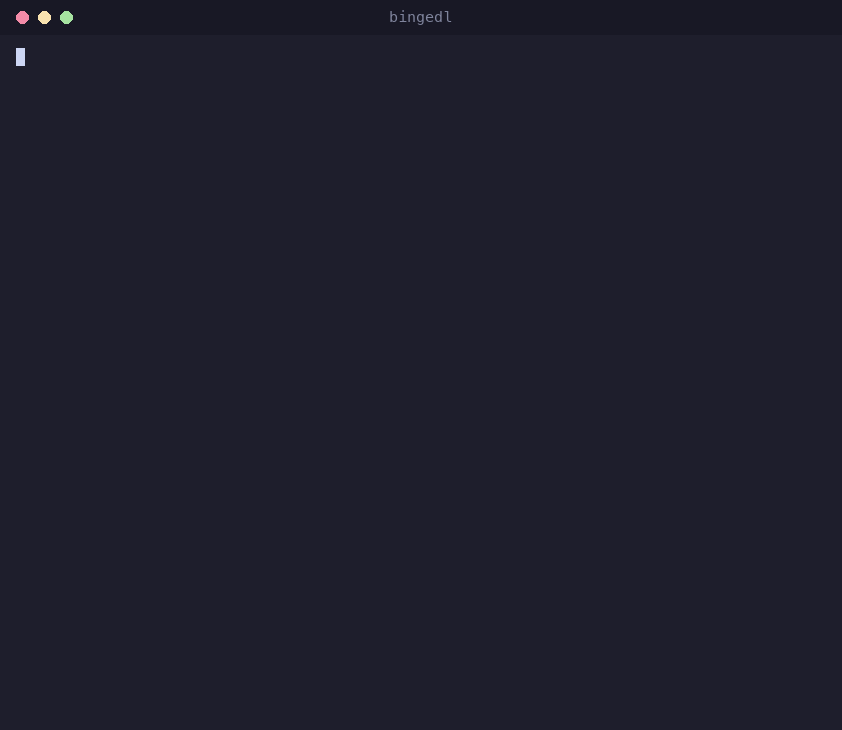

# bingedl

**Download whole seasons from HLS streams. Named, numbered, organized.**

<p align="center"></p>

```console
$ bingedl -s -n "My Show" -S 2 -f season2.txt
[1/8] My_Show_S02Ep01.mp4
      1080p  audio: Ukrainian English
  ✓ My_Show_S02Ep01.mp4 (1.4 GB, 3m12s)
...
Season 2: 8 downloaded, 0 skipped, 0 failed
```

You give it the `.m3u8` links of the episodes you are entitled to download. It picks the
best quality, keeps the audio tracks you want, and produces tidy files:
`Series/My Show/Season 02/My_Show_S02Ep01.mp4`.

## Why bingedl

General tools such as [yt-dlp](https://github.com/yt-dlp/yt-dlp) and
[N_m3u8DL-RE](https://github.com/nilaoda/N_m3u8DL-RE) are excellent and much more powerful.
bingedl is a thin layer on top of `ffmpeg` built around one workflow: *a pile of episode
links in, a correctly named season out*.

- **Season-aware.** Episode numbers are assigned for you; `@season` / `@start` in a list file.
- **Movie and series modes** with separate folders and naming.
- **Best quality by default**, optional cap (`-q 1080`) or ask each run.
- **Audio track picker:** default, all, ask, or by language (`-a uk,en`).
- **Safe by design:** downloads to `*.part`, verifies duration, then renames; existing files are skipped.
- **Retries** on network errors; no pointless retries on 403/404.
- **Picks up where you left off:** the menu remembers your last series and the next episode; links that failed are saved to `~/.config/bingedl/last-failed.txt`, ready to re-run with `-f`.
- **Progress bar (one combined status line with `-j`), parallel downloads, desktop notifications** (per file / season / everything).
- **Interactive menu and full CLI**, settings saved to `~/.config/bingedl/config`.
- Streams are copied, never re-encoded: fast and lossless.

## Install

Requires `bash` 3.2+, `curl`, `awk`, `sed` and, unless you use a ready-made archive, `ffmpeg`.
macOS and Linux (Windows: WSL).

**Ready-made archive (includes ffmpeg).** Download the file for your system from the
[latest release](https://github.com/NeroDOC/bingedl/releases/latest), unpack it and run `./bingedl`.
The script finds the `ffmpeg` next to it.

| System | Archive |
|---|---|
| macOS, Apple Silicon | `bingedl-vX.Y.Z-macos-arm64.tar.gz` |
| macOS, Intel | `bingedl-vX.Y.Z-macos-amd64.tar.gz` |
| Linux, x86-64 | `bingedl-vX.Y.Z-linux-amd64.tar.gz` |

```sh
tar -xzf bingedl-v*-macos-arm64.tar.gz
cd bingedl-v*-macos-arm64
./bingedl
```

The bundled ffmpeg is an unmodified GPL build, see `FFMPEG-NOTICE.txt` in the archive. On macOS, if
Gatekeeper blocks it (the archive was downloaded in a browser), run `xattr -dr com.apple.quarantine .`
in the unpacked folder.

**From source** (you install ffmpeg yourself, e.g. `brew install ffmpeg`):

```sh
git clone https://github.com/NeroDOC/bingedl.git
cd bingedl
ln -s "$PWD/bingedl" /usr/local/bin/bingedl   # optional
```

<!-- When released: brew install NeroDOC/tap/bingedl -->

## Quick start

```sh
bingedl                                         # interactive menu
bingedl -m -n "Movie Title" https://.../master.m3u8
bingedl -s -n "My Show" -S 1 URL1 URL2 URL3     # episodes 1..3
bingedl -s -n "My Show" -S 2 -e 5 -f links.txt  # start from episode 5
bingedl -s -n "My Show" -f links.txt --dry-run  # preview names and folders
```

### List file

```
# comment
@season 1
https://example.com/e1/master.m3u8
https://example.com/e2/master.m3u8
@season 2          # resets the episode counter to 1
@start 5           # the next link is episode 5
https://example.com/s2e5/master.m3u8
```

### Options

| Option | Meaning |
|---|---|
| `-m`, `-s` | movie / series (inferred when omitted) |
| `-n NAME` | title / series name |
| `-S N`, `-e N` | season, first episode |
| `-f FILE` | list file (repeatable, `-` = stdin) |
| `-q N\|auto\|ask` | max height |
| `-a auto\|all\|ask\|uk,en` | audio tracks |
| `-o DIR` | output folder for this run |
| `-j N`, `-r N` | parallel downloads, retries |
| `--overwrite`, `--dry-run`, `--no-progress`, `--settings` | |
| `--about` | author, links and version/OS/ffmpeg info to paste into bug reports |

## Settings

`bingedl --settings` (or menu item 3). Most values accept `auto`.

| Key | Values | Default |
|---|---|---|
| `MOVIES_DIR`, `SERIES_DIR` | paths | `~/Movies/bingedl/{Movies,Series}` |
| `MAX_HEIGHT` | `auto` / `ask` / number | `auto` (best) |
| `AUDIO` | `auto` / `ask` / `all` / `uk,en` | `auto` (default track) |
| `RETRIES`, `JOBS` | `auto` / number | `auto` (2, 1) |
| `LAYOUT` | `folders` / `flat` | `folders` |
| `SPACES` | `underscore` / `keep` | `underscore` |
| `NOTIFY_FILE`, `NOTIFY_SEASON`, `NOTIFY_DONE` | `on` / `off` | `on` |
| `FFMPEG` | `auto` / path | `auto` |

## What it does not do

- **DRM.** Streams protected by FairPlay, Widevine or PlayReady are detected and reported;
  bingedl does not and will not circumvent them. If a link needs a license server, use the
  offline-download feature of the service you pay for.
- **Find links for you.** You bring the `.m3u8` URLs.
- **Subtitles.** Not yet (see roadmap).

Use it only for content you have the right to download.

bingedl is an independent open-source tool. It is not affiliated with, endorsed by or
connected to any streaming service or brand, including any whose name resembles it.

## FAQ

**I get `HTTP 403`.** Tokenised links expire. Copy a fresh one.

**It says the stream is DRM-protected.** See above; nothing to configure.

**Where is the config?** `~/.config/bingedl/config` (plain `KEY="value"` lines).

**Can I use it in scripts?** Yes: exit code is non-zero if any episode failed;
`--no-progress` gives plain output.

## Roadmap

- [x] End-to-end test in CI with a local HLS server
- [ ] Native Windows version: `bingedl.ps1` (PowerShell, with the interactive menu), ffmpeg from BtbN builds, zip in releases
- [ ] Subtitle track selection
- [ ] Single static binary for macOS / Linux / Windows
- [ ] Homebrew tap and Scoop bucket

## Development

```sh
tests/selftest.sh
tests/e2e.sh        # needs ffmpeg, ffprobe, python3; scripts/fetch-ffmpeg.sh DIR downloads them
shellcheck -x bingedl tests/*.sh scripts/*.sh
```

Issues and PRs are welcome.

## License

MIT
